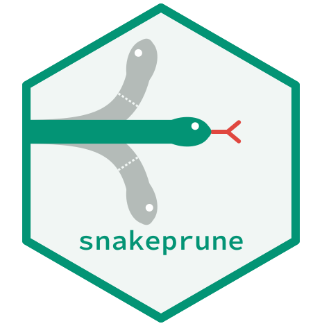

# snakeprune <picture><source media="(prefers-color-scheme: dark)" srcset="docs/logo/hex-3snakes-dark.svg"/></picture>

Find 'orphan' files in a `snakemake` project's `results/` directory and delete them.


## Motivation

Experimentation in bioinformatics typically entails exploration of an ever-expanding number of parameters, flags, procedures, etc. Encoding these as wildcards in the paths to output files in your `snakemake` rules leads to a growing tree of redundant files under `results`, e.g.
* `results/{sample}/{replicate}/output.txt` becomes
* `results/{sample}/{replicate}/{normalisation}/output.txt` becomes
* `results/{sample}/{replicate}/{normalisation}/{count_threshold}/output.txt`

...and so on. If you settle on the third of those output paths, the first two files will be left in the `results` directory tree. When working with a very large number of files (say, one per human gene), multiple iterations clutter up your filesystem over time and stir the bloodlust of your HPC team. To my knowledge `snakemake` provides no way of cleaning these files up.

`snakeprune`:
- ingests the `snakemake` workflow
- builds regex patterns from `rule` output files
- walks the project's `results/` tree
- reports files that match no pattern

`snakeprune` can delete these files or move them to a designated trash directory whilst preserving the same output path from `results` onwards.

As with any program intended to delete files: USE AT YOUR OWN RISK! And, as ever, RTFM.

## Install

`snakeprune` is a small pure-Python CLI.

```bash
pipx install git+https://github.com/twillis209/snakeprune.git
```

Or, to install from a clone:

```bash
git clone https://github.com/twillis209/snakeprune.git
cd snakeprune
pip install -e .
```

`snakeprune` needs Python 3.12 or later. It calls into the workflow's own Python environment via subprocess, so `snakemake` (version 8 or later) must be importable in *that* environment — but it does not need to live in the same env as `snakeprune`.

## Usage

```bash
# Dry run: list orphans, take no action
snakeprune scan path/to/pipeline path/to/results

# Survey a big tree: orphan counts and sizes per directory
snakeprune scan path/to/pipeline path/to/results --summary

# Reversible delete: move orphans into a trash directory
snakeprune scan path/to/pipeline path/to/results --trash path/to/trash

# Delete outright (prompts for confirmation; --yes for scripts)
snakeprune scan path/to/pipeline path/to/results --delete
```

`path/to/pipeline` is the directory that holds `Snakefile` or `workflow/Snakefile`. Run the scan from your workflow's environment, where `snakemake` is importable. To keep files permanently, list them in `results/.snakepruneignore`.

All options, `.snakepruneignore`, the deletion flow and exit codes: [docs/usage.md](docs/usage.md).

## Before your first delete

1. Start with `snakeprune scan <pipeline> <results> --summary` to see which directories the orphans are in. On an established pipeline, expect some of them to be files the workflow writes but never declares (see [Limitations](docs/safety.md#limitations)); write a `results/.snakepruneignore` for those, and for any other files you want to keep, before the first `--trash` or `--delete`. Then run a plain `snakeprune scan <pipeline> <results>` and read the orphan list.
2. If the list looks right, re-run with `--trash some/staging/dir` to move (not unlink) the orphans.
3. After a few days of confidence that nothing's missing, delete the trash directory.

`snakeprune` refuses (exit 3, nothing listed) rather than guess wherever a listed file could be live, and a dry run refuses exactly where `--delete` would. What it cannot see is a live file that no rule describes:

- **files a rule writes but does not declare**, which a later rule may still read (index files, per-gene outputs listed in an index file);
- **files only an input function reads**, and outputs of rules that only exist under a config you did not pass with `--configfile`;
- **files reached through symlinks or hard links** in the ways listed under [Limitations](docs/safety.md#limitations).

Read [docs/safety.md](docs/safety.md) before deleting on a pipeline you care about.

## Documentation

- [Usage](docs/usage.md): every option, `.snakepruneignore`, the deletion flow, exit codes
- [Safety and limitations](docs/safety.md): what is refused, and what `snakeprune` cannot detect
- [How it works](docs/how-it-works.md): how the workflow is read and files are matched

## Licence

MIT; see [LICENSE](LICENSE).
